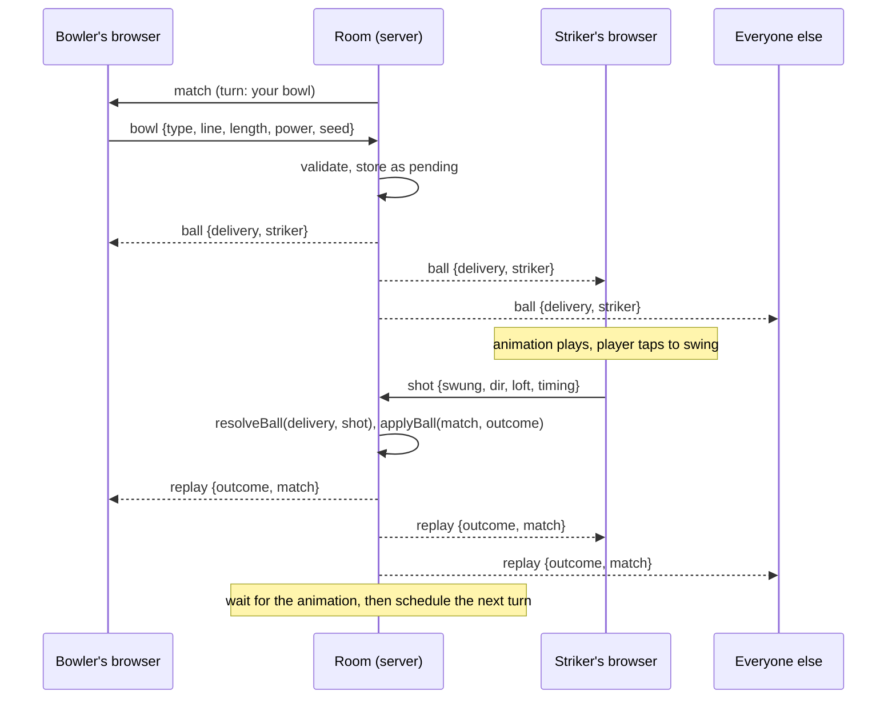

# How multiplayer works

This is a walkthrough of the online side of CricketVerse Arena: how a room is created, how a ball travels from the bowler to everyone's screen, and what happens when someone's connection drops. It covers `server/index.ts`, `src/net/` and `src/game/room.ts`.

## The big idea: one authoritative room

Every match is run by a single `Room` object ([src/game/room.ts](../src/game/room.ts)). The room owns the truth: who is on which team, whose turn it is, the score and the result of every ball.

Players never change the score themselves. They send **intents** ("I bowl this delivery", "I play this shot", "put me on team B") and the room decides what happens, then tells everyone.

This is called an *authoritative server*. It means:

- **Everyone sees the same match.** There is one copy of the state, so clients cannot disagree about the score.
- **Cheating is hard.** A modified client can send a silly shot, but the room validates every message (`validDelivery`, `validShot`) and only the room computes runs and wickets.
- **Clients stay simple.** They render what they are told.

`Room` is plain TypeScript with no browser or Node APIs. It talks to the outside world only through two callbacks:

```ts
interface RoomOutput {
  send(pid: string, msg: HostMsg): void   // to one player
  broadcast(msg: HostMsg): void           // to everyone in the room
}
```

Because of that, the exact same class runs in three places:

| Transport | Where the `Room` runs | Used for |
|---|---|---|
| `server` | Node, behind Socket.IO | Normal online play (preferred) |
| `peer` | The host's browser, players connect over WebRTC (PeerJS) | Fallback if the server can't be reached |
| `local` | Your own browser, no network | Practice against bots |

[`RoomClient`](../src/net/client.ts) hides the difference: the UI calls `create`, `join` and `send` and never knows which transport is in use.

## Rooms and Socket.IO

[server/index.ts](../server/index.ts) keeps a `Map` from room code to a `RoomEntry` (the `Room` plus the sockets of its players).

- **Creating a room:** the client emits `create` with its player id and name. The server makes a 5-letter code (no look-alike characters such as `0`/`O` or `1`/`I`), creates the `Room`, puts the socket in a Socket.IO room with that code, and answers through an **acknowledgement** callback with `{ ok, code }`.
- **Joining:** the client emits `join` with the code. The room checks whether it's full (30 humans) or locked mid-match, then the server acks.
- **Broadcasting:** `broadcast` is just `io.to(code).emit('msg', …)`. Socket.IO rooms do the fan-out.
- **One event for gameplay:** after joining, everything goes through a single `msg` event carrying a tagged union (`{ t: 'bowl', … }`, `{ t: 'shot', … }`). The message types live in [src/net/protocol.ts](../src/net/protocol.ts) and are shared by client and server, so TypeScript checks both ends.

### Messages

| Client → room (`ClientMsg`) | Meaning |
|---|---|
| `setTeam`, `settings`, `addBot`, `fillBots`, `kick` | Lobby actions (most are host-only) |
| `start`, `rematch`, `toLobby` | Match control (host-only) |
| `bowl` | The bowler's delivery: type, line, length, power, a random `seed` |
| `shot` | The striker's input: swung or not, direction, loft, timing |
| `chat` | A chat line (rate-limited to one per 0.8 s) |

| Room → clients (`HostMsg`) | Meaning |
|---|---|
| `lobby` | Full lobby state (players, teams, settings, host) |
| `match` | Full match state (score, overs, whose turn) |
| `ball` | A delivery is on its way: play the bowling animation |
| `replay` | The ball's result, plus the new match state |
| `chat`, `error`, `kicked` | Chat, a toast message, or "you were removed" |

The room sends **whole state snapshots** (`lobby`, `match`) rather than small diffs. A cricket match is tiny (a few KB), so snapshots are simpler and can't drift out of sync.

## The life of one ball



A few details that make this work:

- **Seeded, deterministic physics.** A delivery carries a random `seed`. [physics.ts](../src/game/physics.ts) uses a seeded random generator, so the same delivery and shot always produce the same flight, bounce and result. Only a few bytes cross the network; every screen draws the same ball.
- **Timing is measured locally.** The striker's timing is measured on their own device against their own animation, then sent as a number. Network lag changes *when* the shot arrives, not *how good* it was, so a laggy connection doesn't ruin your batting.
- **The room waits for the animation.** After a ball, `ballAnimationMs` estimates how long clients need to show the run-up, flight, result and any slow-motion replay. Bots don't bowl the next ball until that time has passed.
- **Breaks are just another phase.** At the end of an innings `applyBall` sets `phase: 'break'` and pushes the next innings. The room waits for the animation plus a few seconds, then resumes play. A tie goes to a super over the same way (a one-over innings each, repeated up to three times if tied again), so no extra networking code is needed for it.
- **Stale messages are ignored.** Every ball has a `ballId`. A `shot` for an old ball, or from someone who isn't the striker, is dropped.

## Turns, bots and timeouts

- **Bots** are players with `isBot: true`. When it's a bot's turn, the room calls the AI in [ai.ts](../src/game/ai.ts) (`botDelivery`, `botShot`) and plays the move itself after a short delay.
- **Turn timers:** a human bowler gets 30 s, after which a bot bowls for them. A striker gets 20 s, after which the ball counts as a leave. This stops one idle player from freezing the match.

## Disconnects and reconnecting

Mobile connections drop all the time, so this matters as much as the happy path.

1. **Grace period.** When a player's socket disconnects mid-match, the room marks them `connected: false` and starts a 12-second timer.
2. **A bot takes over.** If they're not back in time, they're marked `away`, everyone gets a chat notice, and `isAuto()` now treats them like a bot. If it's already their turn, the AI moves for them straight away.
3. **Reconnecting.** The Socket.IO client reconnects by itself. On `reconnect`, `RoomClient` re-emits `join` with the same player id (kept in `sessionStorage`), the room recognises them, clears `away`, and sends them the current match snapshot.
4. **Duplicate tabs.** If the same player id connects from a new socket, the old socket is disconnected, so one player never controls two connections.
5. **Host leaves.** The host role passes to another connected human, so the room survives.
6. **Cleanup.** When the last human leaves, the room is deleted after 10 minutes of inactivity.

Players who disconnect from the lobby (not mid-match) are removed straight away, since nobody is waiting on them.

## Protecting the server

The server is public, so it treats every message as untrusted:

- **Rate limiting:** a token bucket per socket (20 messages/second sustained, bursts of 40; creating a room costs 5).
- **Size limits:** Socket.IO's `maxHttpBufferSize` is 64 KB; names, codes and chat are trimmed to fixed lengths.
- **Validation:** settings are clamped (`sanitizeSettings`), deliveries and shots are range-checked, and host-only actions check `pid === hostId`.
- **Capacity:** at most 500 rooms per server (`MAX_ROOMS`) and 30 humans per room.
- **Static files:** paths are normalised and anything outside `dist/` is refused, so `../` tricks can't read other files.

## Peer-to-peer fallback

If the Socket.IO server can't be reached, `create` falls back to [`BrowserHost`](../src/net/host.ts): the host's own browser runs the `Room`, registers the room code with the public PeerJS broker, and friends connect directly over WebRTC data channels. The trade-off is that the room ends when the host closes their tab, which is why the server is preferred.

If the server is reachable but refuses a join (the room is full or locked), the client shows that error instead of falling back, so it never joins the wrong room.

## Design decisions and trade-offs

| Decision | Why | Cost |
|---|---|---|
| Authoritative room instead of trusting clients | One source of truth, no score disputes, harder to cheat | Every action waits for a round trip to the server |
| Same `Room` class on server and in the browser | One implementation of the rules, tested once ([game.test.ts](../src/game/game.test.ts)) | `Room` must stay free of Node and browser APIs |
| Send inputs plus a seed, not physics frames | Tiny messages, identical replays on every screen | Physics must stay deterministic across browsers |
| Full state snapshots instead of diffs | Simple, self-healing after any missed message | Slightly more bandwidth (fine at this size) |
| Socket.IO instead of raw WebSockets | Rooms, acks, automatic reconnect and a polling fallback for strict networks | An extra library and its own protocol on top of WebSocket |
| In-memory rooms, one server | Simple and free to host | Rooms are lost on restart; scaling past one server would need sticky sessions and a shared store such as Redis |

## Try it

```bash
npm run server     # game server on :3001
npm run smoke      # two scripted clients create a room, join and play a full match through it
```

The smoke test ([scripts/smoke-server.ts](../scripts/smoke-server.ts)) also runs against a deployed server: `SERVER_URL=https://your-server npm run smoke`.
